# Fehlerbericht: alte Seite (WordPress/Elementor) und Behebung im Neubau

Analyse vom 22.10.2026. Vorgehen: automatisierter Playwright-Durchlauf aller 25 Seiten der Live-Seite
in drei Viewports (1440 / 820 / 390 px) mit Messung von Overflow, Überschriften, Alt-Texten,
Konsolenfehlern und fehlgeschlagenen Requests; Lighthouse (mobil); manuelle Sichtung. Die
Vorher-Screenshots stammen von `https://egranitadoci.com`, die Nachher-Screenshots vom Build der
neuen Seite (`npm run audit`). Alle Vorher-Bilder liegen in [screenshots/before](screenshots/before),
alle Nachher-Bilder in [screenshots/after](screenshots/after).

## Übersicht

| Nr. | Fehler | Schwere | Status |
|---|---|---|---|
| 1 | Startseite läuft seitlich aus dem Viewport (horizontaler Overflow, Seite erscheint herausgezoomt) | hoch | behoben |
| 2 | „Top“-Button fix oben in der Mitte über dem Logo | mittel | behoben |
| 3 | Menüpunkt „Portfolio“ klickbar statt nur Untermenü | niedrig | behoben |
| 4 | Leistungen/Preise nur als Bild | mittel | behoben |
| 5 | Instagram-Verlinkung | – | geprüft, Link korrekt (siehe Text) |
| 6 | Kontaktformular ohne Spam-Schutz | hoch | behoben (Endpunkt eintragen) |
| 7 | SEO-Mängel: keine Meta-Descriptions, `lang="en-US"`, fehlende H1, keine Alt-Texte, kein Open Graph, keine strukturierten Daten | hoch | behoben |
| 8 | Große graue Leerflächen vor dem Footer (Home, Über mich, Shootings) | mittel | behoben |
| 9 | Footer-Layout: Fußnavigation bricht um, Copyright falsch ausgerichtet, Jahr 2023 | niedrig | behoben |
| 10 | Shootings/Blog: Overflow auf Tablet, Titel brechen mitten im Wort, falsche Großschreibung | mittel | behoben |
| 11 | Datenschutz auf Tablet/Handy herausgezoomt (nicht umbrechender Link) | mittel | behoben |
| 12 | Englischer Cookie-Banner + „Manage consent“-Schwebebutton auf deutscher Seite, Google Analytics/Fonts | mittel | behoben (kein Banner mehr nötig) |
| 13 | Konsolenfehler (CORS) und 34 CSS/JS-Dateien pro Seite | niedrig | behoben |
| 14 | Riesige Originalbilder (bis 13.275 × 9.482 px, 10 MB) | mittel | behoben |
| 15 | Tippfehler und Schreibweisen | niedrig | behoben |
| 16 | Zu kleine Klick-/Tap-Ziele | niedrig | behoben |
| 17 | Zu geringer Textkontrast (4,26:1) | niedrig | behoben |
| 18 | Blogbeiträge ohne semantische Struktur (kein H1, Datum als Absatz) | niedrig | behoben |

## Messwerte vorher / nachher

Lighthouse 12, mobil (Moto-G-Emulation). „Vorher“ = Live-Seite egranitadoci.com, „nachher“ = finaler Build
der neuen Seite, lokal ausgeliefert (auf GitHub Pages kommt noch Netzwerk-Latenz hinzu). Die drei
Qualitätskategorien sind unabhängig von der Netzdrosselung; die Performance-Werte wurden mit tatsächlich
gedrosselter Verbindung (`--throttling-method=devtools`) gemessen.

| Seite | Performance | Accessibility | Best Practices | SEO |
|---|---|---|---|---|
| Startseite vorher | 69 | 92 | 100 | 92 |
| Startseite nachher | 88–93 \* | 100 | 100 | 100 |
| Hochzeit vorher | 76 (simuliert) | 93 | 100 | 85 |
| Hochzeit nachher | 100 | 100 | 100 | 100 |

| Startseite (devtools-Drosselung, mobil) | FCP | LCP | Speed Index | Gesamtgröße |
|---|---|---|---|---|
| vorher | 3,3 s | 6,3 s | 4,8 s | 2.075 KB |
| nachher | 0,9 s | 2,6 s | 5,3 s \* | 876 KB |

\* Der Speed Index der neuen Startseite bleibt wegen des laufenden Bild-Karussells (fortlaufende
Überblendung) höher als bei einer statischen Seite; das drückt den Performance-Wert auf 88–93 trotz
FCP 0,9 s und LCP 2,6 s. Für eine 100 könnte das Karussell auf Mobilgeräten ohne Autoplay starten.

Playwright-Audit (25 Seiten × 3 Viewports):

| Kriterium | vorher | nachher |
|---|---|---|
| Seiten mit horizontalem Overflow | 9 (Startseite in allen Viewports, Shootings + 3 Blogbeiträge Tablet, Datenschutz Tablet/Mobil) | 0 |
| Seiten ohne H1 | 15 von 25 | 0 |
| Seiten ohne Meta-Description | 25 von 25 | 0 |
| Bilder ohne Alt-Text | alle (z. B. 11 auf der Startseite) | 0 |
| Konsolenfehler pro Seite (Desktop) | 6 | 0 |
| `<html lang>` | `en-US` | `de-AT` |

---

## 1. Startseite läuft seitlich aus dem Viewport

**Befund.** Desktop: Dokumentbreite 17.370 px bei 1.440 px Viewport. Tablet: 10.710 px bei 820 px.
Handy: der Layout-Viewport weitet sich auf 1.560 px, die ganze Seite wird herausgezoomt dargestellt
(winzige Schrift) und lässt sich seitlich scrollen. Genau das ist das vom Kunden beschriebene
„out of bounds auf der Startseite“.

**Ursache.** Das Elementor-„Media Carousel“ (Swiper) legt alle 14 Slides nebeneinander; der
Container schneidet den Überlauf nicht ab, dadurch bestimmt die Slide-Reihe die Seitenbreite.

| vorher (Handy, herausgezoomt) | vorher (Tablet: nächster Slide ragt rechts hinein) |
|---|---|
| 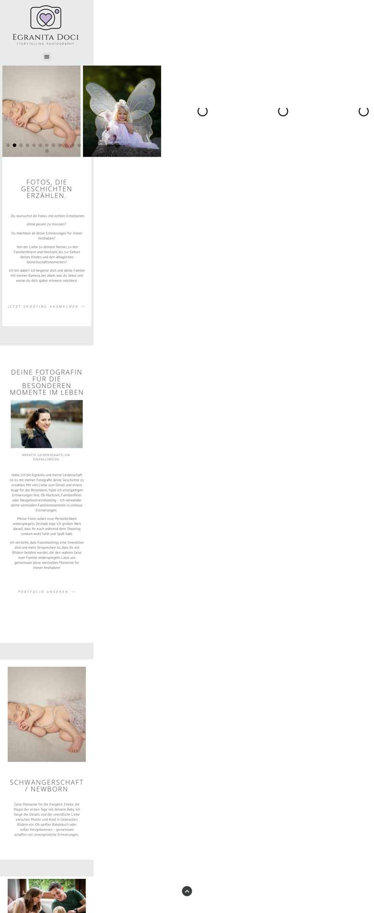 | 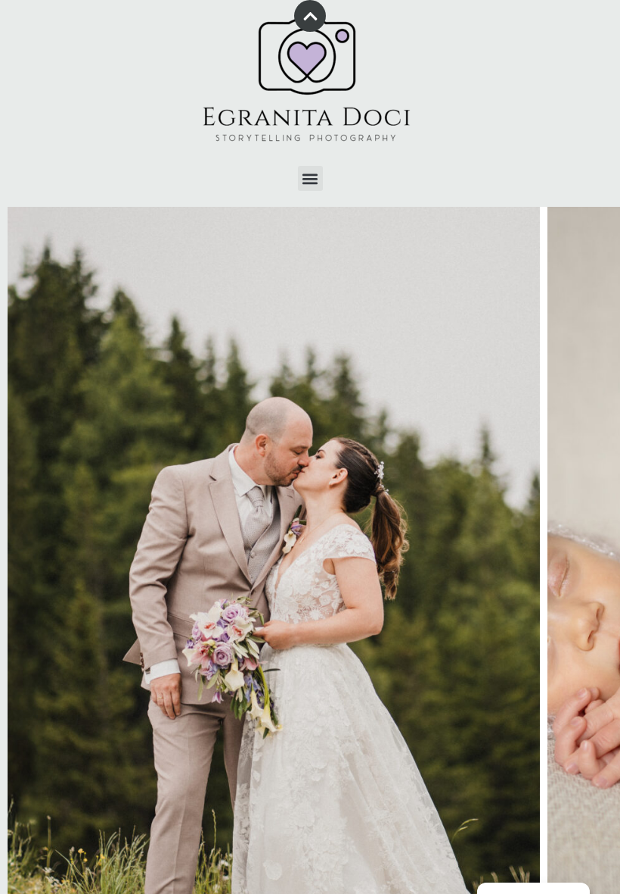 |

Gesamte Breite der alten Startseite auf dem Desktop (17.370 px, stark verkleinert):

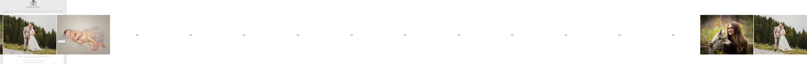

**Behebung.** Eigenes Karussell (`shared/hero-carousel`): die Slides liegen übereinander und werden
überblendet, der Container hat `overflow: hidden` und ein festes Seitenverhältnis; zusätzlich
`overflow-x: clip` auf `body` als Sicherheitsnetz. Der Audit meldet in allen 75
Seiten/Viewport-Kombinationen keinen Overflow mehr.

| nachher (Handy) | nachher (Tablet) |
|---|---|
| 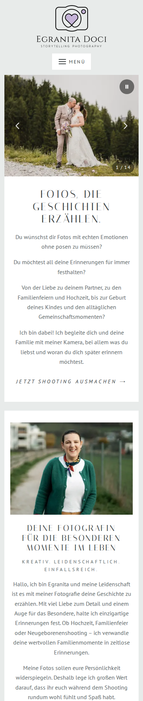 | 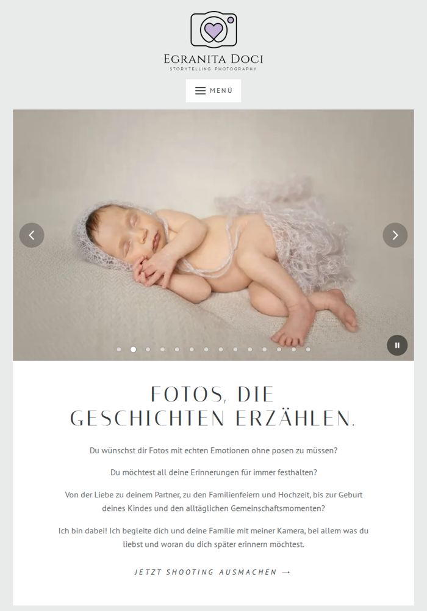 |

## 2. „Top“-Button über dem Logo

**Befund.** Der Nach-oben-Button sitzt fix bei y = 0 in der Bildschirmmitte (Desktop x ≈ 699 px) und
überlagert auf jeder Seite die Oberkante des Logos, auch auf dem Handy. Er ist immer sichtbar, auch
ganz oben, wo er keine Funktion hat.

| vorher (Desktop, Kopfbereich) | vorher (Handy, mit Cookie-Banner) |
|---|---|
|  | 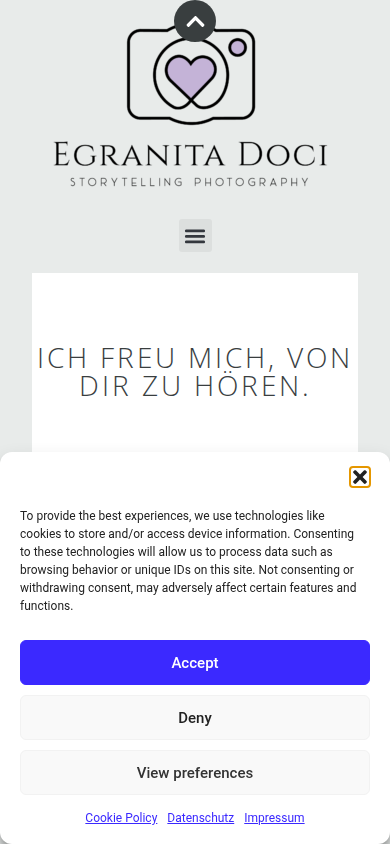 |

**Behebung.** `layout/scroll-top`: Button rechts unten, erscheint erst ab 400 px Scrolltiefe,
48 × 48 px Touch-Ziel, `aria-label`, sanftes Scrollen (respektiert „reduzierte Bewegung“).

| nachher (Kopfbereich ohne Button) | nachher (Button rechts unten beim Scrollen) |
|---|---|
|  | 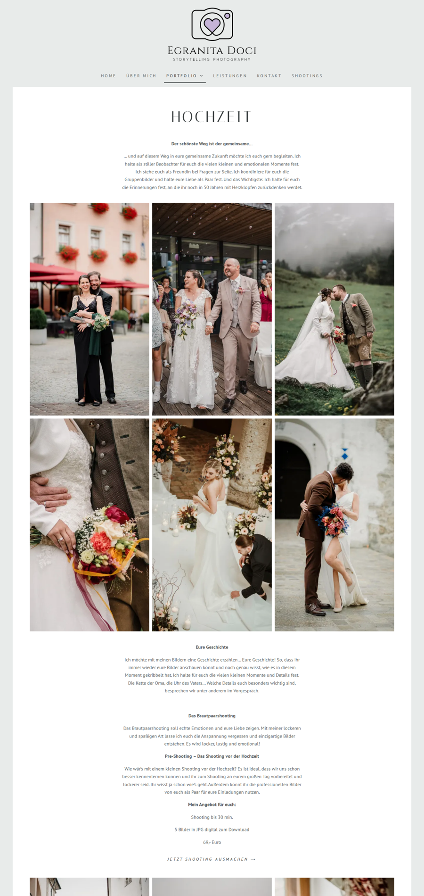 |

## 3. „Portfolio“ im Menü klickbar

**Befund.** Ein Klick/Tap auf „Portfolio“ führt zur Portfolio-Seite, statt nur das Untermenü
(Hochzeit, Taufe, Newborn, …) zu öffnen. Auf dem Handy ist das Untermenü dadurch kaum erreichbar.

**Behebung.** „Portfolio“ ist jetzt ein `<button aria-expanded>`, der nur das Untermenü öffnet (am
Desktop zusätzlich per Hover/Fokus). Die Portfolio-Seite bleibt über die „Portfolio ansehen“-Links
erreichbar. Umsetzung in `layout/header`.

## 4. Leistungen und Preise nur als Bild

**Befund.** Die Preisliste ist ein JPG im Instagram-Story-Format (1.440 × 2.560 px). Suchmaschinen,
KI-Assistenten und Screenreader sehen keinen einzigen Preis; auf dem Handy wird das Bild auf
358 px Breite skaliert, die Schrift ist dann ca. 6 px groß und nicht kopierbar.

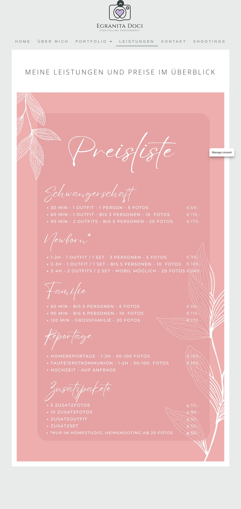

**Behebung.** Preisliste als echter Text (`pages/services`, Daten in `price-list.ts`), gegliedert
nach Schwangerschaft, Newborn, Familie, Reportage, Zusatzpakete, mit `OfferCatalog`-JSON-LD. Das Bild
bleibt als Download verlinkt.

| nachher (Desktop) | nachher (Handy) |
|---|---|
| 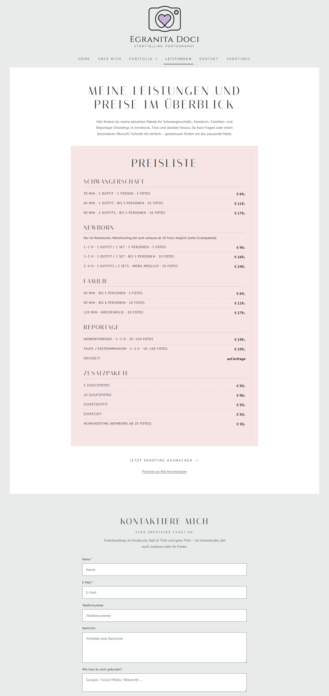 | 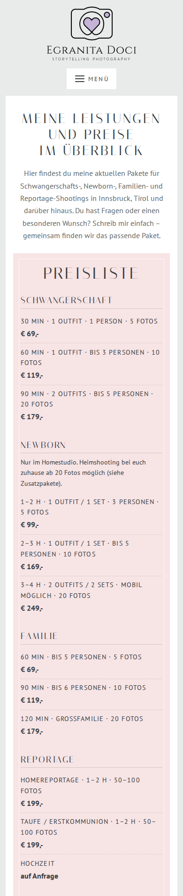 |

## 5. Instagram-Verlinkung

**Befund.** Alle 25 Seiten verlinken im Footer auf `https://www.instagram.com/egranita/`. Der Aufruf
im Browser zeigt das richtige Profil („Egranita Doci | Fotografin | Tirol“, @egranita). Der Link
selbst ist also nicht defekt. Was auffiel: Die Social-Icons sind nur 32 px groß und werden auf dem
Handy vom „Manage consent“-Button bzw. vom Cookie-Banner überlagert, sodass Taps ins Leere gehen
können. Außerdem zeigt der Pinterest-Link auf ein privates Profil („just a random business and
economics student“).

**Behebung.** Social-Links mit 44 × 44 px Klickfläche, `target="_blank"`, `rel="noopener"` und
`aria-label`; keine überlagernden Elemente mehr. **Offen:** mit Egranita klären, was genau an der
Instagram-Verlinkung nicht funktionierte (eventuell der Link *von* Instagram *zur* Website) und ob der
Pinterest-Link bleiben soll (`src/app/core/site.ts`).

## 6. Kontaktformular ohne Spam-Schutz

**Befund.** Das Elementor-Formular hatte weder Honeypot noch Captcha noch Zeitsperre, der Posteingang
wurde zugespamt.

**Behebung.** `layout/footer/contact-form`: unsichtbares Honeypot-Feld (Bots füllen es aus, Eingabe
wird still verworfen), Absenden erst nach 3 Sekunden möglich, Pflicht-Checkbox Datenschutz,
Validierung von Name/E-Mail/Telefon. Da GitHub Pages keine Mails versendet, geht der Versand über einen
Google-Apps-Script-Web-App im Google-Workspace-Konto von frankford-it (serverseitig Honeypot, Pflichtfelder,
Link-Spam und Stundenlimit; Anleitung im README). Ohne eingetragenen Endpunkt öffnet
der Button eine vorbereitete E-Mail.

## 7. SEO-Mängel

**Befund** (alle 25 Seiten): keine Meta-Description; `<html lang="en-US">` auf einer deutschen Seite;
keine H1 auf Startseite, Leistungen, Shootings, Impressum und allen 9 Blogbeiträgen; sämtliche Bilder
ohne Alt-Text; keine Open-Graph-/Twitter-Tags (Links in WhatsApp/Facebook ohne Vorschau); keine
strukturierten Daten; Google Fonts von Google-Servern (DSGVO-Risiko); 3 Google-Fonts-Varianten
„Open Sans Hebrew“ geladen, die mit CORS-Fehler scheitern. Lighthouse SEO: 92 (Start) / 85 (Hochzeit).

**Behebung.** `core/seo.service.ts` setzt pro Seite Titel, Description, Canonical, Open Graph
(eigene 1200 × 630-Vorschaubilder in `public/og`), Robots; `core/schema.ts` liefert JSON-LD
(`LocalBusiness`, `Person`, `WebSite`, `Service`, `FAQPage`, `BlogPosting`, `BreadcrumbList`,
`OfferCatalog`). `<html lang="de-AT">`, genau eine H1 je Seite, beschreibende Alt-Texte für alle 278
Bilder, selbst gehostete Fonts, `sitemap.xml`, `robots.txt`, `llms.txt`. Lighthouse SEO: 100.

## 8. Leere Flächen vor dem Footer

**Befund.** Elementor-Sections mit Mindesthöhe erzeugen vor dem Footer große graue Leerflächen:
Startseite ca. 650 px, Über mich ca. 900 px, Shootings ca. 1.100 px.

| vorher (Shootings) | vorher (Über mich) |
|---|---|
| 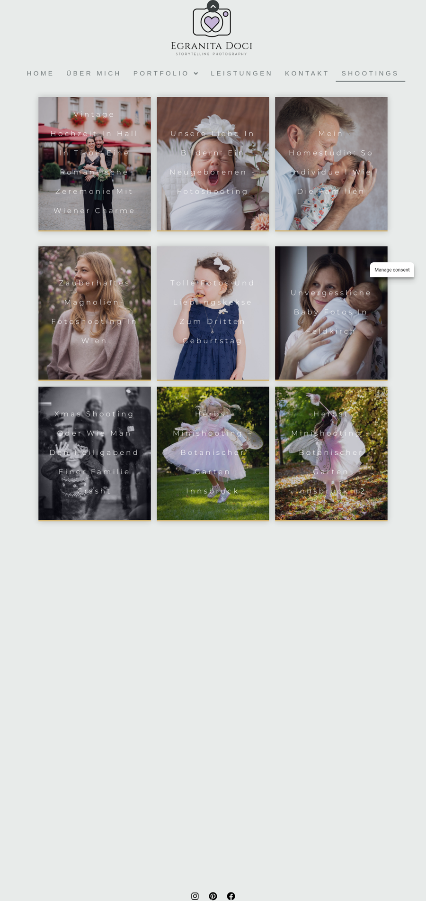 | 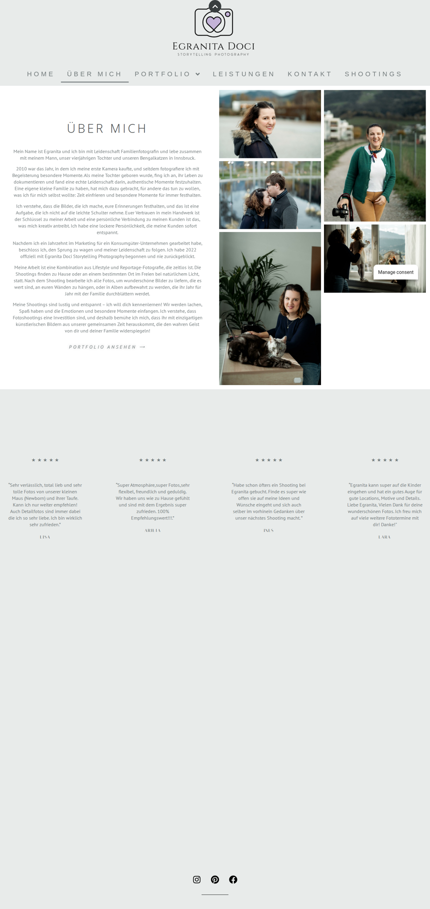 |

**Behebung.** Inhalt fließt natürlich, keine festen Mindesthöhen.

| nachher (Shootings) | nachher (Über mich) |
|---|---|
| 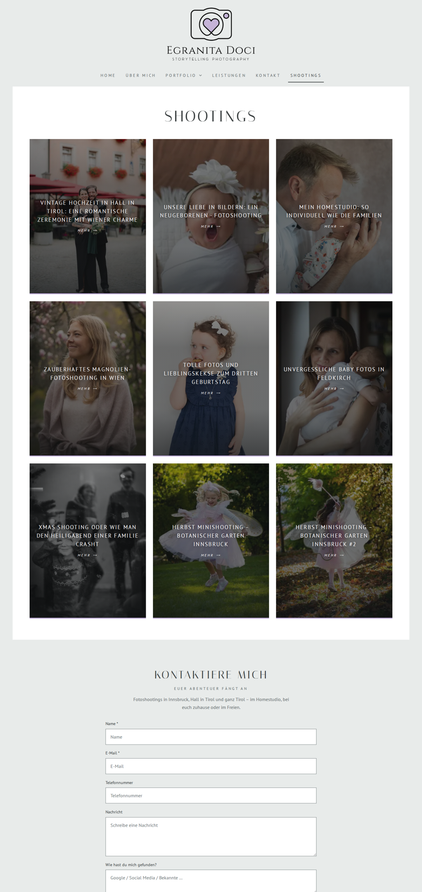 | 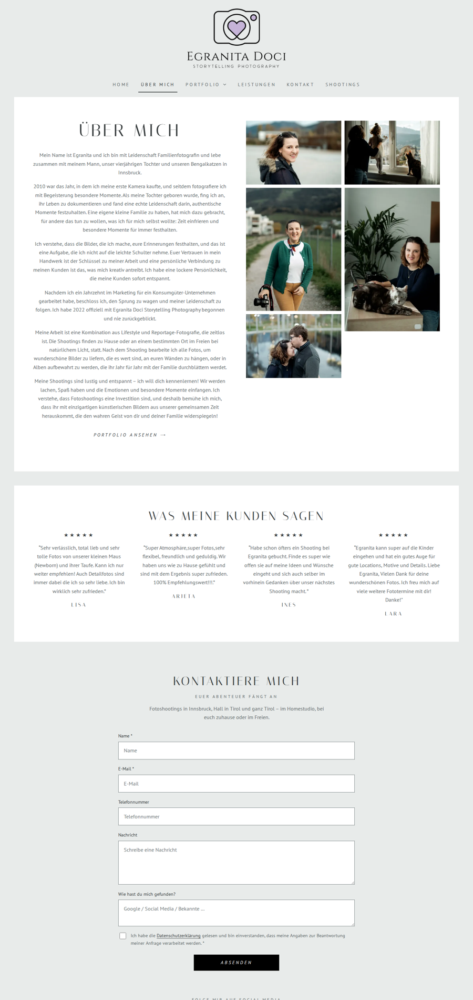 |

## 9. Footer-Layout

**Befund.** Die Fußnavigation bricht um („Cookie Policy (EU)“ allein in der zweiten Zeile), das
Copyright steht versetzt links unten, das Jahr ist fest auf 2023 gesetzt.

| vorher | nachher |
|---|---|
| 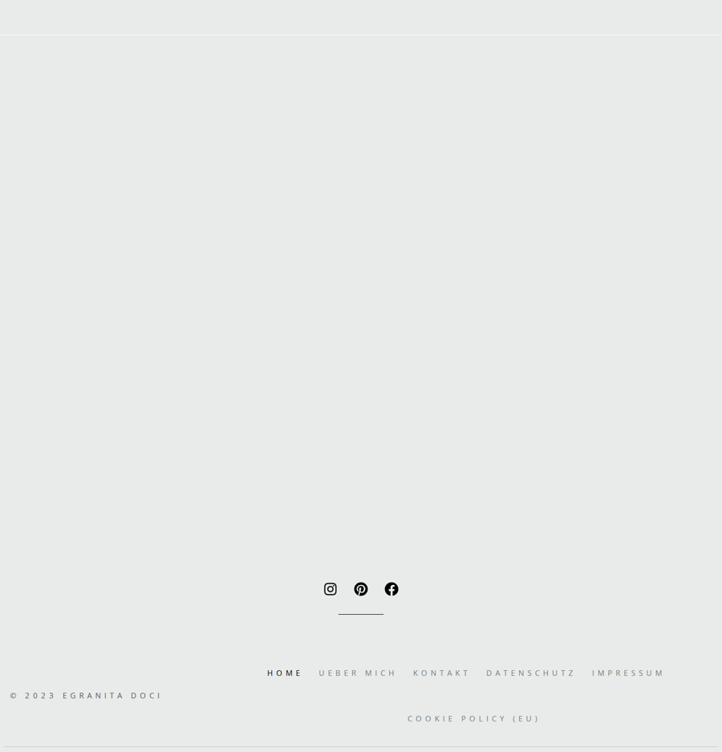 | 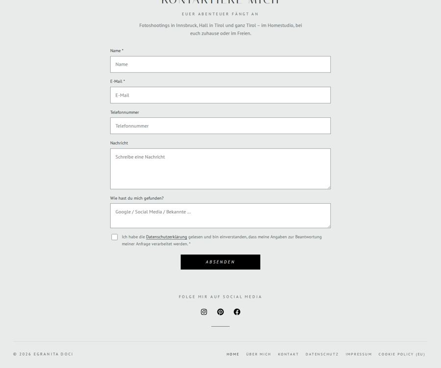 |

**Behebung.** Flex-Layout mit sauberem Umbruch, Jahr wird automatisch gesetzt, Links mit 44 px Höhe.

## 10. Shootings/Blog: Overflow und Kartentitel

**Befund.** Auf dem Tablet (820 px) ist das Kartenraster 842 px breit (Scrollbalken). Die Titel mit
großem Buchstabenabstand brechen mitten im Wort um („Unvergesslich e Baby Fotos“), und
`text-transform: capitalize` erzeugt falsche Großschreibung („Vintage Hochzeit In Hall In Tirol“).

| vorher (Tablet) | nachher (Tablet) |
|---|---|
| 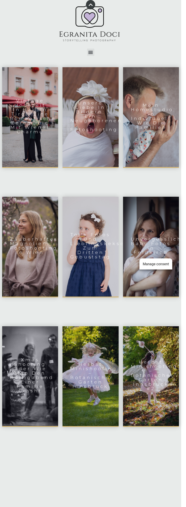 | 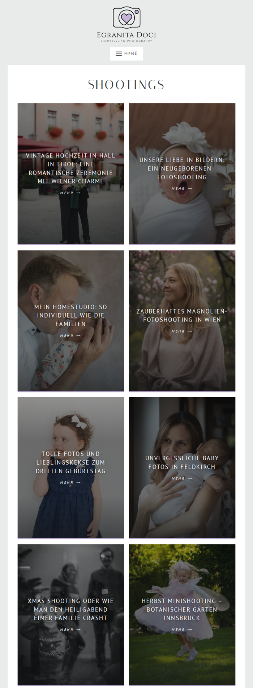 |

**Behebung.** Responsives Raster (3 / 2 / 1 Spalten), Titel in Originalschreibweise, moderater
Buchstabenabstand, Karten sind ganzflächig verlinkt.

## 11. Datenschutzerklärung herausgezoomt

**Befund.** Ein langer, nicht umbrechender Link des AdSimple-Generators weitet das Layout auf 975 px
(Tablet) bzw. 839 px (Handy); die ganze Seite wird verkleinert dargestellt.

| vorher (Handy) | nachher (Handy) |
|---|---|
| 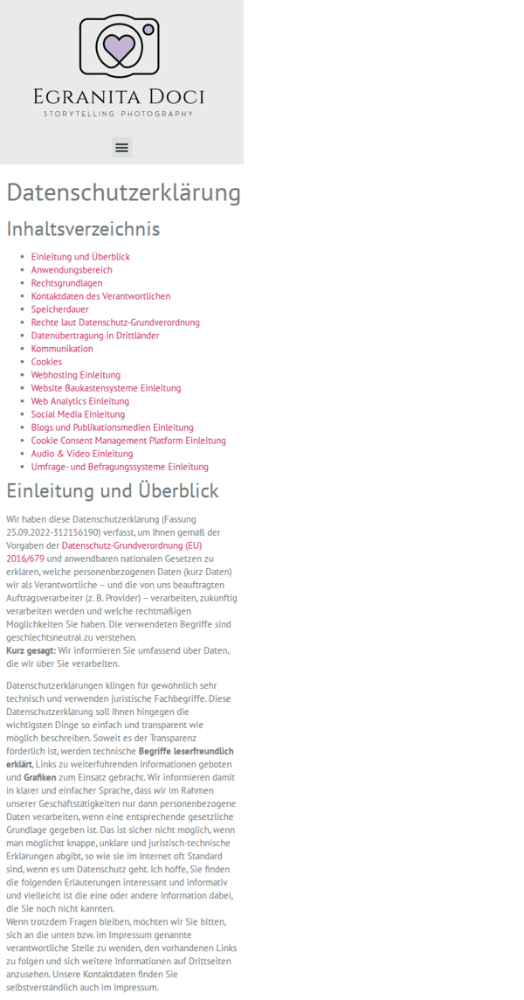 | 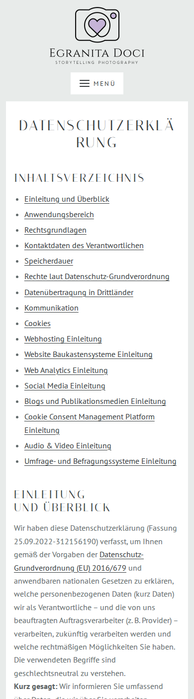 |

**Behebung.** `overflow-wrap: anywhere` für Links und Tabellenzellen in Fließtexten, Inhaltsverzeichnis
mit funktionierenden Ankern.

## 12. Cookie-Banner und Tracker

**Befund.** Complianz zeigt einen englischen Banner („To provide the best experiences, we use
technologies like cookies…“) und einen dauerhaften „Manage consent“-Schwebebutton; Google Analytics
(G-KF7XYGNYWY) und Google Fonts werden geladen.

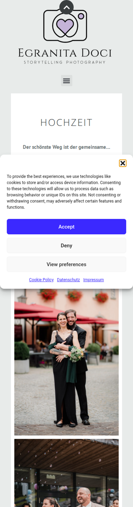

**Behebung.** Die neue Seite setzt keine Cookies, lädt keine Tracker und keine externen Fonts. Ein
Consent-Banner ist damit nicht nötig. Die übernommene Datenschutzerklärung/Cookie-Policy beschreibt
noch den alten Stand und sollte aktualisiert werden (siehe README, Abschnitt „Rechtliches“).

## 13. Konsolenfehler und Ladeverhalten

**Befund.** 6 Konsolenfehler je Seite (CORS der Hebrew-Fonts), 18 CSS- und 16 JS-Dateien (jQuery,
jQuery Migrate, Swiper, Elementor, Elementor Pro, Complianz, gtag).

**Behebung.** 0 Konsolenfehler, 1 externe CSS-Datei (6 KB) plus inline-kritisches CSS, rund 99 KB
JavaScript (komprimiert) für die gesamte Seite, Inhalte je Seite als eigener Chunk.

## 14. Riesige Originalbilder

**Befund.** Im Karussell der Startseite liegt `Oldtimer-_-Egranita-Doci-2.jpg` mit
13.275 × 9.482 px (2,7 MB), im Beitrag „Unsere Liebe in Bildern“ `IMG_4449.jpg` mit 5.774 × 3.849 px
(10,3 MB). Die Startseite wiegt mobil 2,1 MB.

**Behebung.** Alle 278 Bilder als WebP in bis zu vier Breiten (480/960/1440/1920 px) mit
`srcset`/`sizes`, `width`/`height` gegen Layout-Springen, Lazy Loading außerhalb des sichtbaren
Bereichs, Hero-Bild mit hoher Priorität. Startseite mobil: 823 KB.

## 15. Tippfehler und Schreibweisen

- „Eurer Abenteuer fängt an“ → „Euer Abenteuer fängt an“
- „Schwangerschaft / NeWBORN“, „Hinter den kulissen“ → korrekte Schreibweise
- Footer „Ueber mich“ → „Über mich“
- Flip-Box „Mein Homestudio“ verlinkte auf `http://www.egranitadoci.com/…` (http + www, Umleitung)

## 16. Zu kleine Klick-/Tap-Ziele

**Befund.** 4–6 Bedienelemente je Seite unter 24 px (Social-Icons, Karussell-Punkte), auf Datenschutz
und Cookie-Policy über 40.

**Behebung.** Navigation, Buttons, Social-Icons, Karussell- und Lightbox-Bedienung mindestens 44 px.

## 17. Textkontrast

**Befund.** Fließtext `#747C7D` auf Weiß ergibt 4,26:1 (WCAG AA verlangt 4,5:1), Lighthouse meldet
den Kontrast auf jeder Seite.

**Behebung.** Textfarbe `#626A6B` (≥ 5,5:1 auf Weiß, ≥ 4,6:1 auf dem grauen Hintergrund); optisch
nahezu identisch.

## 18. Blogbeiträge ohne Struktur

**Befund.** Titel als H2 unter dem Bild, Datum als normaler Absatz, keine Artikel-Metadaten.

**Behebung.** `<article>` mit H1, `<time datetime>`, `article:published_time`,
`BlogPosting`-JSON-LD mit Autorin und Veröffentlichungsdatum, Breadcrumbs.

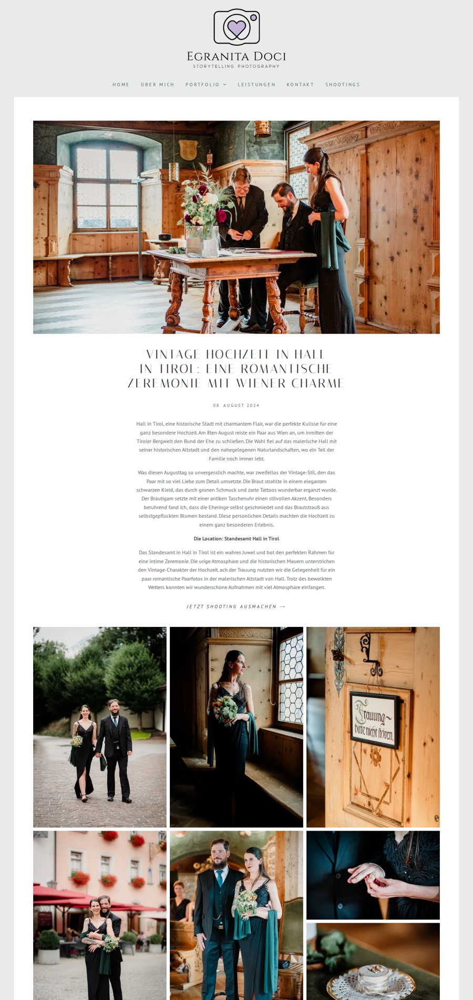

---

## Zweite Prüfrunde: Code-Review des Neubaus

Nach dem ersten Build wurde der Neubau selbst von sechs unabhängigen Prüfperspektiven (Inhaltstreue,
SEO/GEO, Barrierefreiheit, Angular/SSR, responsives Layout, Sicherheit/Performance) untersucht; jeder
Befund wurde von einem zweiten, skeptischen Prüfer gegengeprüft. 16 Befunde wurden bestätigt und
behoben, 1 wurde verworfen:

| Bereich | Befund im Neubau | Behebung |
|---|---|---|
| Inhalt | „Das könnte dich interessieren“: Karte „Herbst Minishooting … #2“ verlinkte in 6 Beiträgen auf Beitrag #1 | Konverter korrigiert, Test prüft Karten-Links |
| Inhalt | Kindergarten-FAQ „Welche ist die optimale Bekleidung?“ hatte die vierteilige Tipp-Liste verloren | FAQ-Modell um Listen erweitert, Liste wiederhergestellt |
| Inhalt | Cookie Policy: zerstückelte E-Mail-Adresse, Complianz-Bedienelemente als Text | bereinigt |
| Inhalt | Datenschutz: Inhaltsverzeichnis verwies auf adsimple.at, Überschriften ohne IDs | interne Anker, IDs erhalten, sanftes Scrollen |
| Inhalt | Zwischenüberschrift „Die Location“ nicht mehr fett; Newborn-Alt-Texte weniger beschreibend als im Original | fett übernommen, Original-Alt-Texte bevorzugt |
| SEO | JSON-LD verwies per @id auf Entitäten, die nur auf der Startseite ausgegeben wurden; `makesOffer` statt `hasOfferCatalog`; Bild-URLs auf nicht vorhandene 1440-px-Varianten; fehlendes OG-Bild für Leistungen | ein @graph mit WebSite/LocalBusiness/Person auf jeder Seite, korrekte Property, OG-Bilder |
| Barrierefreiheit | Karussell ohne Pause-Möglichkeit (WCAG 2.2.2); Kartentitel auf Fotos unter 4,5:1; Untermenü per Fokus sichtbar trotz `aria-expanded="false"`; Esc verlor den Fokus; Formularrahmen/-platzhalter zu kontrastarm, Fehler nicht mit Feldern verknüpft | Pause/Play-Button, dunklerer Verlauf, Untermenü nur per Button/Hover, Fokusführung, Kontraste, `aria-describedby` |
| Angular | Lightbox ließ die Seite bei Routenwechsel gesperrt; Wischen schloss die Lightbox; `appScrollTo` ignorierte `<base href>` | Aufräumen beim Zerstören, Wisch-Erkennung, `prepareExternalUrl` |
| Layout | Datenschutz: nicht umbrechende Cookie-Werte in Absätzen; Hero-Ausschnitt 5:2 schnitt Köpfe ab; Lightbox-Pfeile über dem Foto auf Handys; Punkte-Navigation brach um; Footer-Zeile auf Tablets | `overflow-wrap`, 2:1 mit oberem Bildfokus, Pfeile unten, kleinere Punkte, gestapelter Footer |
| Performance | Galerie-Bilder im sichtbaren Bereich lazy; Fonts erst nach dem CSS entdeckt; zweites Hero-Bild konkurrierte mit dem LCP-Bild; `sizes` zu groß auf breiten Monitoren | erste Galeriebilder priorisiert, Font-Preload mit stabilen Dateinamen, verzögertes Nachladen, gedeckelte `sizes` |

Verworfen: „`@angular/forms` im Hauptbundle für das Footer-Formular“ – messbar unerheblich (ca. 18 KB komprimiert).

Adresse: Auf der alten Seite standen zwei verschiedene Adressen (Kontakt: Innsbruck, Impressum: Hall in
Tirol). Freigabe 22.10.2026: Hall in Tirol – jetzt einheitlich auf der Kontaktseite, in den strukturierten
Daten und in `llms.txt`. Alte Bild-URLs unter `/wp-content/uploads/` liefern nach dem Umzug 404 (GitHub Pages
kann nicht umleiten – Google indexiert die neuen WebP-Bilder neu).

---

## Offene Punkte für die Übergabe

1. Formular-Backend bereitstellen (Google-Apps-Script-Web-App im frankford-it-Workspace, Anleitung im README) und die URL in `src/app/core/site.ts` eintragen; bis dahin öffnet „Absenden“ nur das Mailprogramm.
2. Domain umstellen: Repository-Variable `CUSTOM_DOMAIN`, DNS beim Provider, „Enforce HTTPS“ (Anleitung im README).
3. Datenschutzerklärung und Cookie-Policy an den neuen Stand anpassen (keine Cookies/Tracker/WordPress).
4. Instagram: Rückfrage beim Kunden, was genau nicht funktionierte; Pinterest-Link prüfen.
5. Nach dem Domainwechsel: Sitemap in der Google Search Console einreichen.
